### About me

I'm a full-stack developer from Bangalore. I've built and shipped a lot of apps end to end: web platforms on React, Next.js and Node, and cross-platform mobile apps with React Native and Expo, from the database and API all the way to the screens people tap on.

The other half of me is game development. I write open-source Godot plugins and native SDK bindings, and I'm currently building **[Ziva](https://ziva.sh)**, an AI assistant for Godot, Unity and Unreal.

### Featured projects

<table>
  <tr>
    <td width="50%" valign="top">
      <h4><a href="https://github.com/3ddelano/epic-online-services-godot">Epic Online Services Godot</a></h4>
      
The easiest way to use Epic Online Services in Godot 4.2+: auth, lobbies, P2P, achievements and more. Written in C++ with a full demo project.

      
      
    </td>
    <td width="50%" valign="top">
      <h4><a href="https://github.com/3ddelano/discord.gd">discord.gd</a></h4>
      
A Discord Bot API wrapper for Godot. Write Discord bots entirely in GDScript.

      
      
    </td>
  </tr>
  <tr>
    <td width="50%" valign="top">
      <h4><a href="https://github.com/3ddelano/gdai-mcp-plugin-godot">GDAI MCP for Godot</a></h4>
      
An MCP server that lets Claude, Cursor, Windsurf and VS Code create scenes, scripts and resources and read errors in the Godot editor.

      
      
    </td>
    <td width="50%" valign="top">
      <h4><a href="https://github.com/3ddelano/discord-game-sdk-godot">Discord GameSDK for Godot</a></h4>
      
An unofficial Discord GameSDK wrapper for Godot 4.x: rich presence, activities and more, with a demo project.

      
      
    </td>
  </tr>
</table>

<b>More Godot experiments</b>

 

- [Discord UI Godot](https://github.com/3ddelano/discord-ui-godot): the Discord app UI rebuilt in Godot
- [Godot Editor Discord Presence](https://github.com/3ddelano/godot-editor-discord-presence): show what you're doing in the Godot editor on Discord
- [Draw Anywhere](https://github.com/3ddelano/draw-anywhere-godot): sketch directly on top of the Godot editor
- [Dataclasses Godot](https://github.com/3ddelano/dataclasses-godot): easy dataclasses for GDScript
- [Slide Puzzle](https://github.com/3ddelano/slide-puzzle-godot): the classic slide puzzle game

### Tech I work with

  <picture>
    <source media="(prefers-color-scheme: dark)" srcset="https://skillicons.dev/icons?i=godot%2Ccpp%2Cts%2Cjs%2Cpython%2Creact%2Cnextjs%2Cnodejs%2Ctailwind%2Cpostgres%2Csupabase%2Cmongodb%2Cdocker%2Cvercel%2Cgit%2Clinux%2Candroidstudio%2Cfigma&perline=9&theme=dark">
    
  </picture>

  
  
  

If my plugins or tools save you time, a coffee keeps them going ☕

